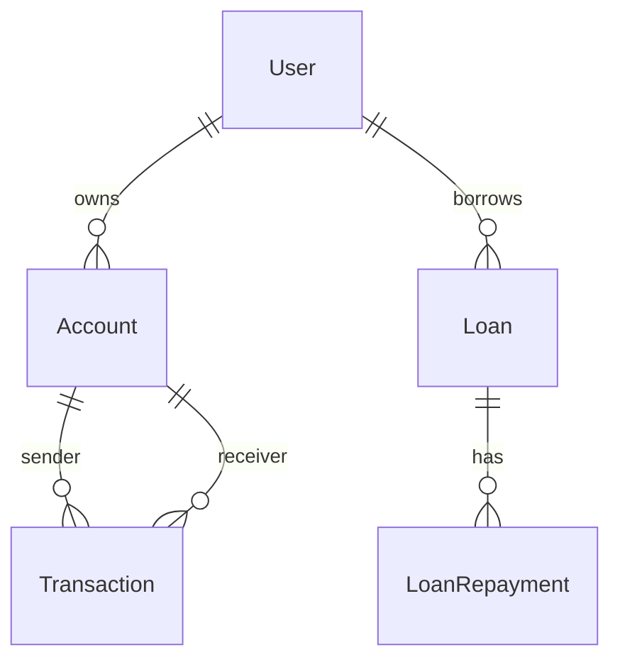

# Digital Banking Management System

Simulated digital banking app (Next.js App Router, TypeScript) serving frontend and backend via Route Handlers. PostgreSQL on Neon via Prisma.

## Features
- Role-based access (ADMIN/STAFF/CUSTOMER)
- Accounts, transfers with locking + idempotency, deposit/withdrawal requests, loans with EMI schedule, flagged transactions, dashboards, settings.

## Roles & Permissions
| Role | Capabilities |
|------|--------------|
| ADMIN | Full management, approvals, settings, reversal |
| STAFF | Register customers, create accounts, review requests/loans, flag |
| CUSTOMER | Own accounts, transfers, requests, loans |

## Redux Toolkit Architecture
Global store with configureStore; feature slices; RTK Query base API with tag invalidation; typed hooks.

## RTK Query Implementation
createApi with fetchBaseQuery to /api, tagTypes, baseQuery wrapper handles 401 redirect and error toast.

## Authentication Strategy
NextAuth credentials, JWT sessions, role/status in token; requireRole re-checks DB status.

## Transaction Processing Logic
prisma.$transaction Serializable; SELECT ... FOR UPDATE in id order; idempotency key check; PIN/limits/balance validations; fee logic.

## Database Structure (ERD)

## Security Implementation
requireRole on every route; ownership scoping; Zod validation; Decimal money; no hash leakage; consistent errors.

## Environment Variables
DATABASE_URL, DIRECT_URL, NEXTAUTH_SECRET, NEXTAUTH_URL.

## Local Setup
npm install; cp .env.example .env; npx prisma migrate dev; npm run seed; npm run dev.

## Deployment
Neon pooled DATABASE_URL + direct DIRECT_URL. Vercel build runs prisma migrate deploy then next build. postinstall generates client. Seed production via npx prisma db seed.

## Demo Credentials
admin@bank.com / Admin123!
staff@bank.com / Staff123!
alice@bank.com / Customer123! (PIN 1234)
bob@bank.com / Customer123! (PIN 1234)

## Extra Libraries
clsx, lucide-react, sonner, date-fns, decimal.js (via Prisma), bcryptjs.
'@ | Set-Content README.md